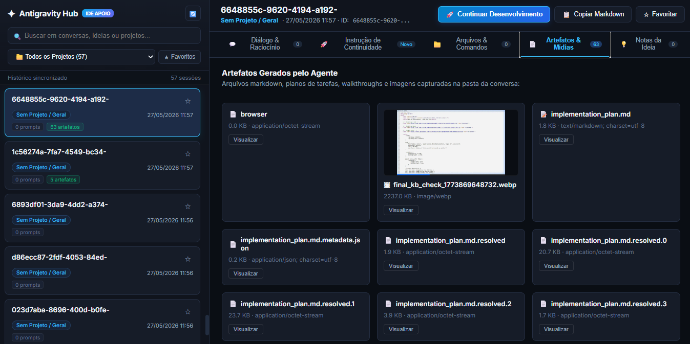

# ✦ Antigravity Hub

> Leitor de sessões do Antigravity/Gemini + gerador automático de instruções de continuidade para novas sessões na IDE.




Uma ferramenta leve para te ajudar a **explorar conversas do Antigravity / Gemini**, resgatar ideias, consultar códigos gerados e **gerar automaticamente instruções de continuidade** para novas sessões na IDE — útil principalmente quando você perdeu alguma conversa ou precisa retomar um projeto do zero.

---

## 📋 Requisitos

- **Python 3.9+**
- Navegador moderno (Chrome, Firefox, Edge)
- Acesso à pasta local onde o Antigravity/Gemini salva as sessões

---

## 📦 Instalação

```bash
git clone https://github.com/hacxors/antigravity-hub-reader.git
cd antigravity-hub-reader

```

---

## 🚀 Como Iniciar

### Opção 1: Dois cliques no Windows
Dê dois cliques no arquivo:
```cmd
iniciar_leitor.bat
```

### Opção 2: Pelo Terminal
```bash
py antigravity_reader.py
# ou
python antigravity_reader.py
```

O servidor será iniciado em `http://127.0.0.1:8765` e seu navegador padrão será aberto automaticamente.

---

## ✨ Principais Funcionalidades

### 1. 🚀 Gerador de Instrução para Nova Sessão (Continuity Hub)
- **O problema que resolve**: quando uma conversa encerra ou você abre uma nova sessão no Antigravity, você precisa explicar todo o contexto do projeto novamente.
- **A solução**: o Antigravity Hub analisa a conversa selecionada e monta automaticamente um resumo estruturado contendo:
  - Projeto e Workspace de trabalho.
  - Objetivo original da conversa.
  - Arquivos tocados e modificados.
  - Comandos executados no terminal.
  - Onde você parou (último status).
  - Templates rápidos: *"Continuar de onde parou"*, *"Revisar & Corrigir Bugs"*, *"Testar & Finalizar Módulo"*, *"Explicar Arquitetura"*.
- Basta clicar em **"Copiar Instrução de Continuidade"** e colar no campo de prompt da nova sessão do Antigravity!

### 2. 🔍 Descoberta & Indexação 100% Abrangente
- Localiza e lê todas as fontes de histórico:
  - Pastas `brain/<conv_id>/`
  - Transcripts oficiais `transcript_full.jsonl` e `transcript.jsonl`
  - Arquivos de resumo `overview.txt`
  - Bancos de dados SQLite `*.db` e Protobuf `*.pb`
- Identifica automaticamente o nome do projeto (ex: `ProjectName`, `_DragonForce`, `hubDigital`, etc.) e caminhos reais de workspace.

### 3. 💬 Diálogo & Raciocínio Inteligente com Blocos Recolhidos & Filtros
- **Blocos Recolhidos por Padrão (Máx 3 Linhas)**: toda mensagem (prompt do usuário ou resposta do Antigravity) inicia recolhida exibindo uma prévia compacta de até 3 linhas com gradiente suave de fade out, evitando rolagem infinita.
- **Expansão sob Demanda**:
  - Clique no card ou em **"▾ Expandir turno completo"** para ler o conteúdo integral.
  - Botões **"📂 Expandir Todos"** e **"📁 Recolher Todos"** no topo para alternar a conversa inteira com 1 clique!
- **Filtros Avançados no Diálogo**:
  - **Campo de Busca Interna**: digite qualquer termo, função, erro ou comando para filtrar apenas os turnos correspondentes (com realce visual amarelo).
  - **Pills de Filtro com Contadores**:
    - `Todos (N)`
    - `👤 Prompts (N)`
    - `✦ Respostas (N)`
    - `💻 Com Código (N)`
    - `⚙ Com Ferramentas (N)`
- **Alternância Limpo vs Técnico**: toggle para exibir ou ocultar os detalhes de comandos de terminal e ferramentas de sistema.
- **Realce de blocos de código**: destaque de sintaxe colorido com cabeçalho de linguagem e botão individual de copiar.

### 4. 📁 Arquivos & Comandos Executados
- Painel dedicado listando todos os arquivos tocados na sessão e os comandos rodados no terminal PowerShell/Bash com botões de cópia rápida.

### 5. 📄 Visualizador de Artefatos & Mídias
- Pré-visualização integrada de arquivos `.md` (walkthroughs, tarefas, notas) e imagens/screenshots geradas nas conversas.

### 6. 💡 Bloco de Notas & Favoritos (Persistência Local)
- Marque qualquer conversa com **estrela (★)** para acesso prioritário.
- Anote suas próprias ideias, arquiteturas e metas em um bloco de notas salvo localmente no arquivo `antigravity_ideas_and_notes.json`.

---

## 🗂 Estrutura do Projeto

```
antigravity-hub-reader/
├── antigravity_reader.py
├── iniciar_leitor.bat
├── requirements.txt
├── LICENSE
├── README.md
└── docs/
    └── screenshot.png
```

---

## 🤝 Contribuindo

Pull requests são bem-vindos! Antes de mudanças grandes, abra uma **issue** para discutirmos o que você pretende fazer.

---

## 📄 Licença

Distribuído sob a licença **MIT**. Veja o arquivo [LICENSE](LICENSE) para mais detalhes.